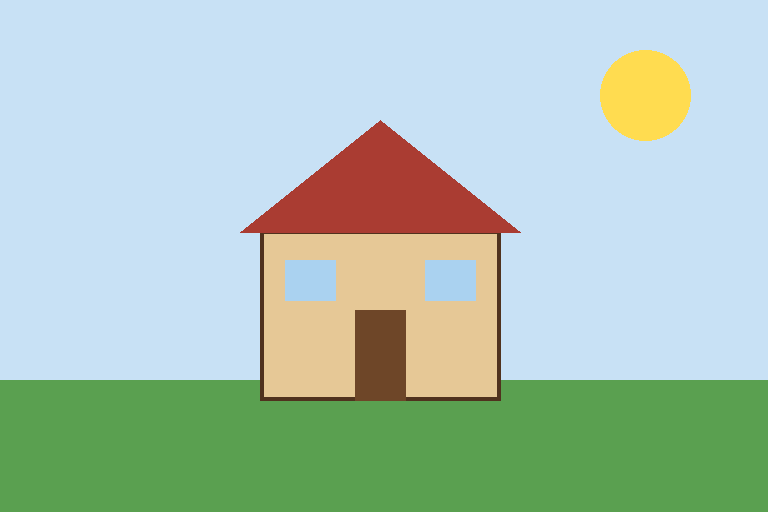
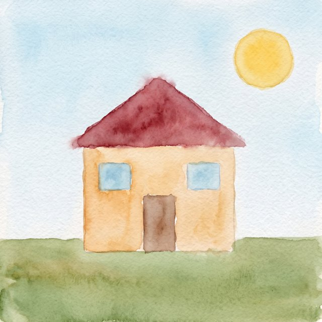
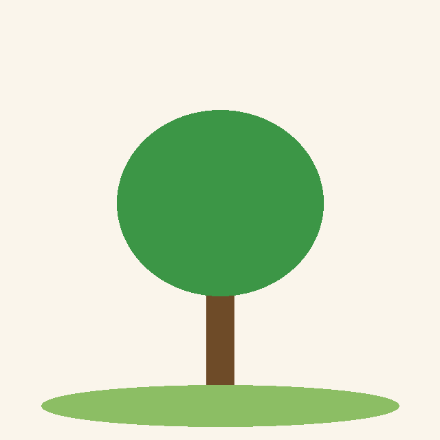
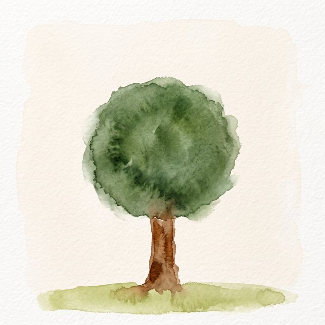

# GAS Connection

**Batch image generation and editing with Google AI Studio's Nano Banana models, straight from Claude Code, using the AI Studio account you're already signed into. No API key needed.**

Hand Claude a folder of images and a prompt. Claude asks which model and resolution you want, then runs each image through [Google AI Studio](https://aistudio.google.com) in your own browser and saves the results into your project.

| Input | Prompt | Output (Nano Banana 2, 2K, 1:1) |
|---|---|---|
|  | *"Repaint this as a soft watercolor painting with visible paper texture."* |  |
|  | same |  |

> **Unofficial.** This project is not affiliated with or endorsed by Google. It automates the AI Studio *web app* in your browser, under your account. Automated use of the web UI may go against Google's terms of service, so use it at your own risk and within your plan's limits. If you have API billing, the official Gemini API is the supported route.

## Why

Image models in AI Studio's web app are often available on your plan while a free API key has **zero** image quota (`429 … free_tier_requests, limit: 0`). GAS Connection uses what you already have: your browser session.

## How it works

```
Claude Code ──(Claude in Chrome extension)──► your browser tab on aistudio.google.com
     │                                              │  gas_bridge.js: set model/resolution,
     │  gas.py: job queue, file names               │  attach image, run, wait, download
     ▼                                              ▼
 ./gas-outputs/<job>/  ◄──── gas.py collect ──── ~/Downloads/gas_<item>.jpg
```

- **`gas_bridge.js`** is injected into the AI Studio tab. It picks the resolution, aspect ratio and thinking level, fills the prompt, clicks Run, waits for the image and downloads it.
- **`gas.py`** (standard-library Python) keeps a resumable job queue in `./.gas/` and files results under `./gas-outputs/<job>/<original-name>.jpg`.
- The bridge caches itself in the page's localStorage, so after the first load each navigation needs one short call to re-arm it.
- Each image takes two browser round trips. Typical times are about 15 s at 1K, 25 s at 2K on Nano Banana 2, and 45 s for Nano Banana Pro at 4K (5056×3372).

Tested end to end (Nov 2026):
- one image per run
- several images in one prompt
- text-to-image
- 512/1K/2K/4K and aspect-ratio selection
- Pro's draft images skipped
- a refusal reported with its reason in about 6 s
- a wrong-model guard

## Requirements

- [Claude Code](https://claude.com/claude-code): the CLI, the desktop app or an IDE extension
- The **Claude in Chrome** extension, connected, in a Chromium browser (Chrome, Brave or Edge)
- That browser signed into an AI Studio account whose plan includes the image models
- Python 3.8+ (Pillow is optional; it's only used to shrink inputs over 9 MB)

## Install

**As a plugin (recommended)**, in Claude Code:

```
/plugin marketplace add LawLaw09/gas-connection
/plugin install gas-connection@gas-connection
```

**Or copy the skill** into a single project (or into `~/.claude/skills/` for all projects):

```bash
git clone https://github.com/LawLaw09/gas-connection
cp -r gas-connection/skills/aistudio-images your-project/.claude/skills/
```

Then add `gas-outputs/` to your project's `.gitignore` if you don't want results committed. The `.gas/` state folder ignores itself.

## Use

Just ask Claude in your project:

- *"Turn every image in `assets/raw/` into a clean product shot on a white background."*
- *"Put the logo from logo.png onto the mug in mug.jpg."* (all images go in one prompt)
- *"Generate 4 hero images of a mountain cabin at dawn, 16:9."* (text-to-image)
- `/aistudio-images` (or `/gas-connection:aistudio-images` when installed as a plugin)

Claude asks which **model**, **resolution** and **aspect ratio** to use, unless you've already said:

| Model | ID | Resolutions | Good for |
|---|---|---|---|
| Nano Banana 2 *(default)* | `gemini-3.1-flash-image` | 512, 1K, 2K, 4K | Most jobs: quality plus speed |
| Nano Banana Pro | `gemini-3-pro-image` | 1K, 2K, 4K | Best quality, text inside images |
| Nano Banana 2 Lite | `gemini-3.1-flash-lite-image` | 1K | Fast recolors, stickers, bulk |
| Nano Banana (original) | `gemini-2.5-flash-image` | — | Legacy |

Aspect ratios: Auto, 1:1, 9:16, 16:9, 3:4, 4:3, 3:2, 2:3, 5:4, 4:5, 21:9. Nano Banana 2 and Lite also offer 4:1, 1:4, 8:1 and 1:8. These are what AI Studio offered in November 2026, and the bridge reads the live options from the page.

## `gas.py` reference

Run it from your project root; Claude does this for you.

```bash
gas.py new [IMAGES|FOLDERS...] --prompt "..." [--model ID] [--resolution 2K] [--aspect 16:9]
           [--thinking High] [--together] [--count N] [--prompts map.json] [--out DIR] [--name JOB]
gas.py next | collect | status | reset [JOB]
gas.py fail ITEM "reason"
gas.py list | models | doctor | bridge
```

- `--together` sends all the inputs in one prompt, for compositing or style references.
- `--prompts map.json` gives each image its own prompt: `{"cat.png": "make it a lion", "dog": "..."}`.
- `--count N` with no inputs makes N text-to-image items.
- Jobs are resumable. `next` always returns the first pending item, and `reset` re-queues failed items.
- `GAS_DOWNLOADS=/path` overrides the download folder, and `GAS_ROOT=/path` overrides the project root.

## Troubleshooting

| Symptom | Fix |
|---|---|
| `locked: true` / "Unlock Nano Banana" | Your AI Studio plan doesn't include that model. Pick another one. |
| "Image recitation block" | The model refused a near-copy of known imagery. Very plain shapes trigger it, so use a richer input or prompt. |
| `collect` finds nothing | Your browser saves somewhere else or asks where to save each file. Set `GAS_DOWNLOADS` or turn off "Ask where to save". Run `gas.py doctor`. |
| Run button disabled | The upload is still in progress, or you're signed out. Check `gasStatus()`. |
| Rate limit / quota text | The plan limit was reached. Wait and run the same job again later; it resumes. |
| UI changed and something stopped working | Open an issue with what `gasStatus()` returns. The selectors live in `gas_bridge.js`. |

## Privacy

GAS Connection itself sends nothing anywhere: images go from your disk into your own browser tab and on to Google AI Studio, and the results come back to your disk. Like anything you do in Claude Code, your prompts, file paths, page text and any image Claude opens are processed by Claude. There are no API keys, cookies or passwords involved. The extension acts in a tab of your signed-in browser, and Claude never handles your credentials.

## License

MIT
